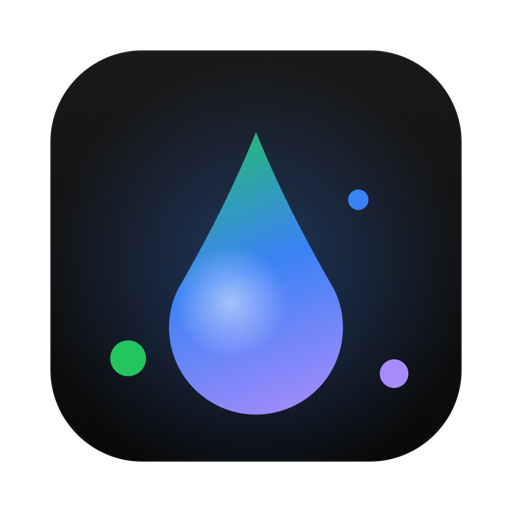
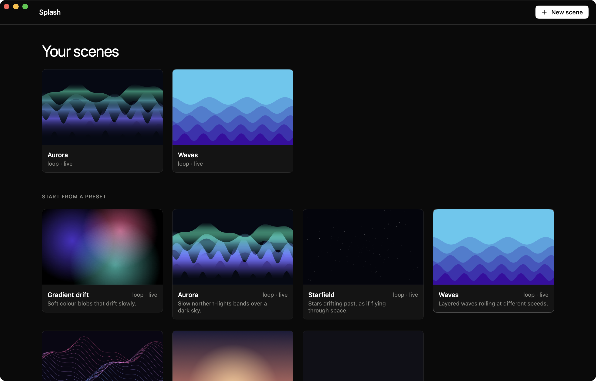
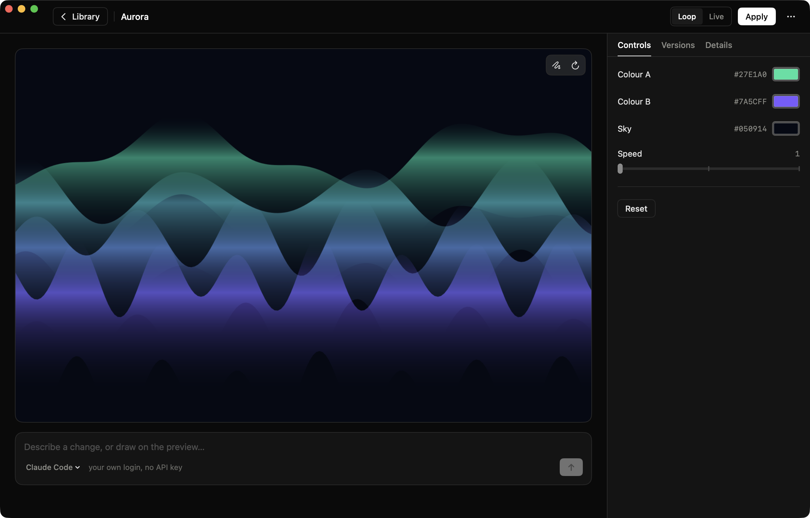

<p align="center">
  
</p>

<h1 align="center">Splash</h1>

<p align="center">
  <b>Animated wallpapers for macOS.</b><br>
  Pick a preset, tune it, or describe it to the AI agent you already use.<br>
  Free, open source (GPL-3.0), and light enough to forget it is running.
</p>

<p align="center">
  <a href="https://github.com/Peppe37/Splash/releases/latest"></a>
  <a href="https://github.com/Peppe37/Splash/releases"></a>
  <a href="https://github.com/Peppe37/Splash/stargazers"></a>
  
  
  <a href="LICENSE"></a>
  <a href="https://github.com/Peppe37/Splash/commits/main"></a>
  <a href="https://github.com/Peppe37/Splash/issues"></a>
  <a href="https://github.com/sponsors/Peppe37"></a>
</p>

<p align="center">
  <a href="https://peppe37.github.io/Splash/">Website</a> ·
  <a href="https://github.com/Peppe37/Splash/releases/latest">Download</a> ·
  <a href="#faq">FAQ</a> ·
  <a href="CHANGELOG.md">Changelog</a> ·
  <a href="https://github.com/Peppe37/Splash/discussions">Discussions</a> ·
  <a href="https://github.com/Peppe37/Splash/issues/new/choose">Report an issue</a> ·
  <a href="#support-the-project">Sponsor ❤️</a>
</p>

<p align="center">
  
</p>

---

> **Status: alpha.** Splash is in early development. Expect rough edges and breaking changes between versions. Feedback is very welcome.

**Contents:** [Why Splash](#why-splash) · [What is it?](#what-is-it) · [Features](#features) · [Screenshots](#screenshots) · [Install](#install) · [Usage](#usage) · [Presets](#presets) · [FAQ](#faq) · [Privacy](#privacy) · [Performance](#performance) · [Roadmap](#roadmap) · [Reviews](#reviews) · [Support and contributing](#support-and-contributing) · [Building from source](#building-from-source) · [Releases](#releases-and-versioning) · [License](#license)

## Why Splash

- **Three ways onto the desktop.** A still picture (nothing runs), a recorded loop (the system's video decoder plays it), or a live scene. Splash uses the lightest one the scene allows.
- **Light.** The app you design in is separate from the wallpaper process, so you can close it. A loop costs about 14 MB and 1% of a core, [measured and repeatable](#performance). No accounts, no analytics, no telemetry.
- **AI, with the agent you already have.** Describe a change, or draw and pin comments on the preview. Splash runs your agent CLI (Claude Code works today) inside the scene's folder. No API key.
- **Your wallpaper stays yours.** Splash remembers the wallpaper you had and puts it back when you ask.

## What is it?

Splash is a free and open-source app that puts animated and procedural wallpapers on your Mac. A wallpaper is a **scene**: a small folder with a web page and a list of controls. Start from a preset, change it with the controls, or describe what you want to an AI agent. It runs in a tiny process in the menu bar, and does nothing until the system tells it something changed.

## Features

- **Library**: your scenes and the presets as cards with a real picture of the scene, drawn by the same code that draws the wallpaper.
- **Large preview and controls**: colours, speed and so on, built from the scene's own list, following your hand live.
- **Still, Loop or Live**: pick how to put the scene on the desktop. A still is set as the real wallpaper. A loop is recorded once, in full resolution and without a jump, and played by the system. A live scene is drawn in real time, for scenes that react to something.
- **AI chat**: the prompt under the preview talks to an agent CLI. Drawings and numbered pin comments on the preview are sent with the request, and the agent changes only what you pointed at.
- **Versions**: one is saved before every AI change and every restore, so any change can be undone.
- **The runner**: a menu bar item (pause, open Splash, start at login) that draws the wallpaper on every display. It pauses when covered, when the screen sleeps or locks, on Low Power Mode and when the Mac is hot, lowers its frame rate on battery, and shows a still picture while paused.
- **A real wallpaper underneath**: a picture of the scene is set as the macOS wallpaper too, so Mission Control, Space changes and new displays match. The wallpaper you had is remembered and can be put back.
- **Command line**: `splash` makes pictures and loops, checks a scene, and asks an agent from a terminal. See [Usage](#usage).
- **Open scenes**: a scene is plain HTML, CSS and JavaScript in a folder you own. A linter checks it, for people and for agents.
- **Updates in one click**: when a new version is out, one button downloads it, checks it and restarts the app, keeping your permissions and starting the wallpaper again.
- **Native settings**: power choices (pause on battery, pause in Low Power Mode, frame rate on battery) and an About page with updates, feedback and support.

## Screenshots

*The library and the editor, with the Aurora preset.*

<p align="center">
  
</p>

## Install

**Requirements:** macOS 14 Sonoma or later.

### With Homebrew

```sh
brew install --cask Peppe37/tap/splash
```

Use the full name once: it also tells Homebrew to trust the [tap](https://github.com/Peppe37/homebrew-tap). Updates come with `brew upgrade --cask splash`. The cask opens the app without the warning described below.

### From the DMG

1. Download `Splash-<version>.dmg` from the [Releases page](https://github.com/Peppe37/Splash/releases/latest).
2. Open the DMG and drag **Splash** to **Applications**.
3. Launch it. macOS will block it the first time, see below.

### First launch from the DMG: allowing the app

*(Not needed if you installed with Homebrew.)* Splash is not notarized by Apple yet (that requires a paid developer account), so macOS says it cannot verify the app. This is expected. To open it:

1. Open **Splash** from Applications. When the warning appears, click **Done** (not "Move to Trash").
2. Open **System Settings → Privacy & Security**.
3. Scroll to the **Security** section, find "Splash.app was blocked" and click **Open Anyway**.
4. Confirm with your password or Touch ID, then click **Open**. You only need to do this once.

Prefer the Terminal? This does the same thing by removing the quarantine flag:

```sh
xattr -dr com.apple.quarantine /Applications/Splash.app
```

The code is fully open source, and the release is built by GitHub Actions from the tagged source. If you would rather not trust a prebuilt binary, [build it yourself](#building-from-source).

### Permissions

Splash did not ask for any system permission in testing. Setting the desktop picture and drawing under your windows need none. **Start at login** is a switch in System Settings → General → Login Items. The AI agent you choose has its own permissions, and runs with your login: see [docs/AGENTS_INTEGRATION.md](docs/AGENTS_INTEGRATION.md).

## Usage

- **Pick a scene** in the library (or a preset, which makes a copy), change the controls, choose **Still**, **Loop** or **Live** next to **Apply**, and press **Apply** (⌘↩). You can close the window: the wallpaper keeps going in the menu bar.
- **Describe a change** in the prompt under the preview. To point at something, press the pencil on the preview, **Draw** or **Comment**, and send. **Versions** (in the inspector) undoes any change.
- **The menu bar drop** pauses the wallpaper, opens Splash again, and switches start at login.
- **To put your old wallpaper back**: the **…** menu → **Put back my previous wallpaper**.
- **Settings** (<kbd>⌘</kbd><kbd>,</kbd>) has the power choices and the About page.

From a terminal, the same scenes:

```sh
splash presets                                   # list the presets
splash init my-scene --preset aurora
splash lint my-scene
splash snapshot my-scene out.png --time 5        # a picture of the scene
splash bake my-scene out.mov                     # one seamless HEVC loop
splash ask my-scene "make it slower and warmer"  # needs an agent CLI
splash-runner my-scene                           # show it live on the desktop (Ctrl+C to stop)
```

## Presets

| Preset | What it is | Ways to apply |
| --- | --- | --- |
| **Gradient drift** | Soft colour blobs that drift slowly | loop, live |
| **Aurora** | Slow northern-lights bands over a dark sky | loop, live |
| **Starfield** | Stars drifting past, as if flying through space | loop, live |
| **Waves** | Layered waves rolling at different speeds | loop, live |
| **Ribbons** | Thin glowing lines flowing across the screen | loop, live |
| **Dusk** | A still gradient with a low sun glow | still |
| **Blank** | A plain colour, a starting point for the AI | still |

Want your own? See [docs/SCENE_FORMAT.md](docs/SCENE_FORMAT.md): a scene is a `scene.json` and a web page.

## FAQ

**macOS says it can't verify the app, or the app doesn't open.**
That is normal for the alpha: see [First launch](#first-launch-from-the-dmg-allowing-the-app). It takes four clicks, once.

**Does it use my AI API key?**
No. Splash has no API key field. The AI feature runs an agent CLI you already installed and signed in to (Claude Code works today), inside the scene's folder. What you type, and any drawing you send, go to that agent, as with any use of it.

**How do I update?**
When a new version is out, the library shows an **Update** button and **Settings → About** has **Update and restart**: it downloads the release from this repository, checks that it is signed with the same identity as the app you are running, replaces the app, opens it again, and starts the wallpaper again if it was running. Your permissions are kept. With Homebrew, `brew upgrade --cask splash` does the same. A copy that is not signed with the project's certificate (a build you made yourself) is not updated this way: the app says so and points to the release page.

**Which agents work?**
Claude Code is tested. Codex is wired up but not tested yet. OpenCode is switched off: in testing it edited files outside the scene. Details in [docs/AGENTS_INTEGRATION.md](docs/AGENTS_INTEGRATION.md).

**Will it drain my battery?**
A still wallpaper costs nothing and a loop costs very little. A live scene pauses on Low Power Mode by default, lowers its frame rate on battery, and stops when covered, when the screen sleeps or locks, and when the Mac is hot. You can change these in **Settings → Power**.

**Does it replace my current wallpaper?**
While a scene is applied, Splash sets a picture of it as your wallpaper, so Mission Control and new displays match. It remembers the wallpaper you had, and **Put back my previous wallpaper** restores it. A dynamic or Aerial wallpaper can only be restored as a picture.

**Why is a moving wallpaper a window?**
macOS has no public way to play an animation as the wallpaper itself, so Splash puts a window at the desktop level, under your icons and windows. To limit the side effects it also sets a still picture as the real wallpaper, and the runner stays out of the Dock and the app switcher. How well this behaves with Spaces, Stage Manager and virtual displays has not been tested enough: please [report](https://github.com/Peppe37/Splash/issues/new?template=bug_report.yml) what you see, with a screenshot.

**Is it really free?**
Yes. Splash is free and open source under the [GPL-3.0](LICENSE): you can use, study, modify and share it. If you share a modified version, it has to stay under the same license, with its source available.

**How do I uninstall it?**
Quit it from the menu bar item, then drag **Splash** from Applications to the Trash. Use **Put back my previous wallpaper** first if you want your old picture. To also remove its data: delete `~/Library/Application Support/Splash` and run `defaults delete com.giuseppe.splash`.

## Privacy

- No analytics, no telemetry, no accounts. Splash never sends your scenes or your drawings anywhere by itself.
- The wallpaper process (the runner) makes no network calls. A scene can only reach the network if its manifest asks for it, and a scene that uses a remote address without asking fails the linter.
- The editor asks GitHub once a day, while it is open, for the list of releases (a single small request, usually answered "nothing changed") to tell you when there is a newer version. You can switch it off in **Settings → About**. It never downloads or installs anything by itself: **Update and restart** does it when you press it. The wallpaper process never uses the network.
- The AI feature sends your text, and any drawing you attach, to the agent CLI you chose, which sends it on as it normally does. Splash does not see an API key.

Found a security problem? See [SECURITY.md](SECURITY.md).

## Performance

Splash is meant to stay out of your way. These figures come from one MacBook Pro (Apple silicon, macOS 26.6), a debug build, simple scenes at 30 fps, sampled with `top` with the pause in Low Power Mode switched off for the test:

| | Runner | Web processes | Total |
| --- | --- | --- | --- |
| **Still** | no process | none | 0 |
| **Loop** (Aurora) | 14 MB, 0.9 to 1.4 % CPU | none | about 14 MB, 1 % of a core |
| **Live** (Waves) | 18 MB, 1.6 % CPU | 2 processes, 115 to 150 MB, about 5 % CPU | 130 to 170 MB, about 7 % of a core |
| **Paused** (Low Power Mode) | 50 to 70 MB with a still frame held | none | 0 % CPU |

- It is one machine and a few runs, not a benchmark. Decoding done by system daemons and the GPU is not counted.
- The loop is the default for scenes that loop: about a tenth of the memory of a live scene and no web processes.
- **Idle**: the runner has no timers. It wakes only for system notifications (thermal, Low Power Mode, power source, sleep, lock, occlusion) and for messages from the editor.
- **Disk**: the DMG is about 2 MB. A loop is a video file in `~/Library/Application Support/Splash/Baked`, a few MB for a 20 second loop.

To measure on your own Mac (no `sudo` needed):

```sh
swift build
scripts/benchmark.sh registry/presets/waves 10          # live
scripts/benchmark.sh registry/presets/aurora 10 --loop  # loop
```

More in [docs/PERFORMANCE.md](docs/PERFORMANCE.md).

## Roadmap

No dates, just direction. Vote with 👍 or suggest more in [Discussions](https://github.com/Peppe37/Splash/discussions) and [issues](https://github.com/Peppe37/Splash/issues).

- **Check the desktop window** against Spaces, Stage Manager, Mission Control and virtual displays, and fix what shows up.
- **More agents**: test Codex, find out why OpenCode edits the wrong folder.
- **More presets**, including a 3D one.
- **Metal runtime**, so live scenes need no web process and use much less memory.
- **Audio-reactive scenes**, **weather and time-of-day scenes**, a **screen saver**, **video export**.
- **Share and install scenes**, with a review of what each one is allowed to do.
- **Signed and notarized builds**, so the first launch needs no extra steps. This depends on the project getting funded, see below.

Full list in [docs/ROADMAP.md](docs/ROADMAP.md).

## Reviews

Used Splash? Leave a review: sign in with GitHub, give 1 to 5 stars and a few words, tied to the version you use ([write one](https://github.com/Peppe37/Splash/issues/new?template=review.yml)). They show on [the website](https://peppe37.github.io/Splash/#reviews), good or bad: only spam and abuse are removed, and the numbers are worked out in the open by [scripts/gen_reviews.py](scripts/gen_reviews.py).

## Support and contributing

- **Questions and ideas:** [Discussions](https://github.com/Peppe37/Splash/discussions).
- **Bugs and feature requests:** [open an issue](https://github.com/Peppe37/Splash/issues/new/choose).
- **Contribute code, scenes or translations:** read [CONTRIBUTING.md](CONTRIBUTING.md).
- **Help it be found:** star the repository and tell a friend, it makes a real difference for an open source project.

### Support the project

Splash is free and made by one person, in the open. If it is useful to you, you can help keep it going:

- ❤️ [**GitHub Sponsors**](https://github.com/sponsors/Peppe37)
- ☕ [**Ko-fi**](https://ko-fi.com/giuseppelapietra)
- ☕ [**Buy Me a Coffee**](https://www.buymeacoffee.com/giuseppelapietra)

Funding goes to the time behind the project, and to the Apple Developer Program, which is what it takes to ship notarized builds with no warning at first launch. Starring the repository and telling a friend helps just as much.

## Building from source

You need macOS 14 or later and a recent Xcode (Xcode 16 or later), and, for the app bundle, [XcodeGen](https://github.com/yonaskolb/XcodeGen).

```sh
git clone https://github.com/Peppe37/Splash.git
cd Splash
swift build                    # the command line tool, the runner and the editor
swift test
.build/debug/splash-editor     # run the editor

brew install xcodegen          # the .app bundle (Splash.app with the runner and the tool inside)
xcodegen generate
open Splash.xcodeproj
```

The Xcode project is generated from `project.yml` and is not committed. If `xcode-select -p` points at the Command Line Tools, run `swift test` with `DEVELOPER_DIR=/Applications/Xcode.app/Contents/Developer`.

## Releases and versioning

Splash follows [Semantic Versioning](https://semver.org/) and keeps a [Keep a Changelog](https://keepachangelog.com/) style [CHANGELOG](CHANGELOG.md). While it is in alpha, versions are `0.x.y-alpha`: `x` goes up for features, `y` for fixes.

Pushing a tag like `v0.1.0-alpha` triggers the release workflow: it checks the tag against the version in `project.yml`, runs the tests, builds the app, packages a DMG and publishes a GitHub release (marked as pre-release when the tag has a suffix) using the changelog entry as notes. Since 0.1.1 releases are signed with a fixed, self-signed certificate (stored as the `SIGNING_P12` and `SIGNING_P12_PASSWORD` secrets, created once with `scripts/setup-signing.sh`), so macOS recognises every update as the same app and keeps its permissions, and the in-app updater can check that an update comes from the same identity. This is not Apple's notarization: the first-launch warning remains. Without the secrets, for example in a fork, the build is signed ad-hoc and the in-app update refuses it. The 0.1.0-alpha release was signed ad-hoc, so updating from it to 0.1.1-alpha is done by hand (download the DMG). The website is deployed to GitHub Pages from the `site/` folder, with the live scenes built from the presets.

## Credits

The agent-driven workflow (skills, a non-interactive command line the agent can call, a live preview, a registry of reusable blocks) follows [HyperFrames](https://github.com/heygen-com/hyperframes) by HeyGen, which does it for video, and so does the flat, border-first look of the app. Splash does it for wallpapers.

## License

Splash is free software, released under the **[GNU General Public License v3.0](LICENSE)**.

- You **can** use it, study the code, modify it and share it, for free.
- If you share a modified version (or a program built on this code), it has to be released under the GPL-3.0 too, with its source.

Contributions are accepted under the [CLA](CLA.md) (a draft).
